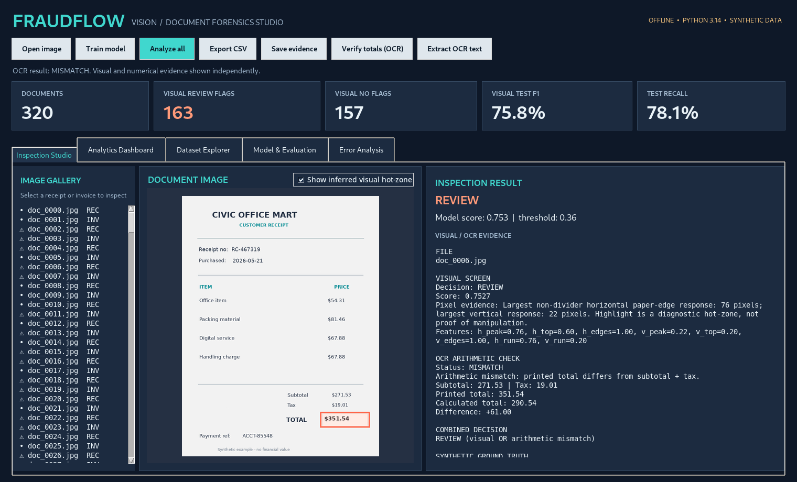
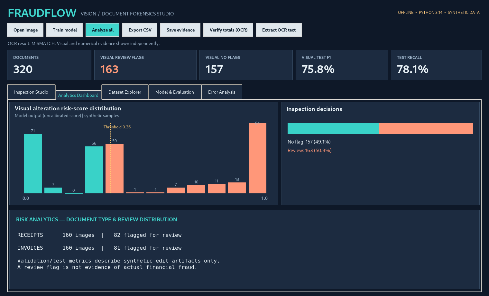
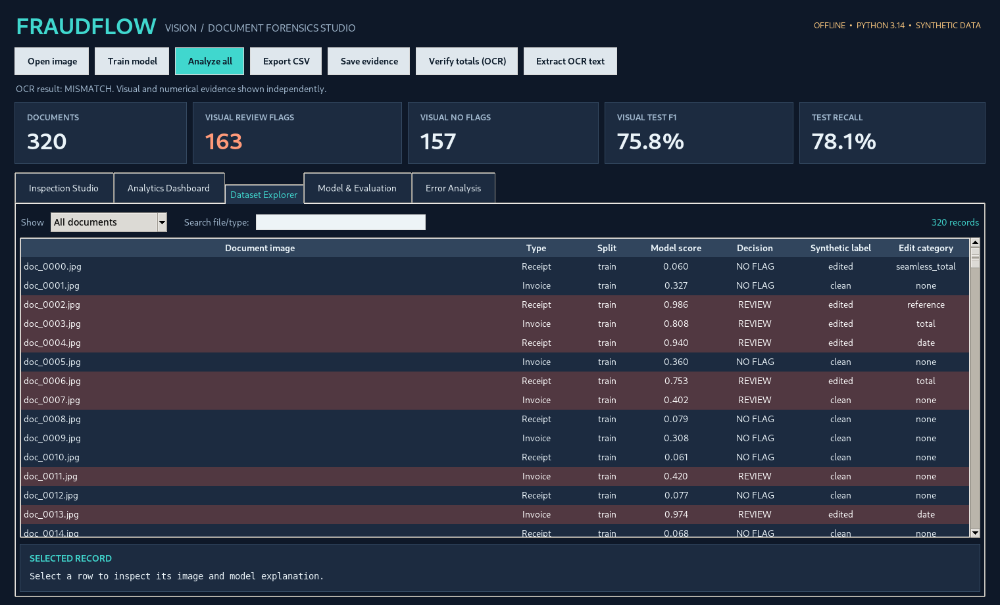
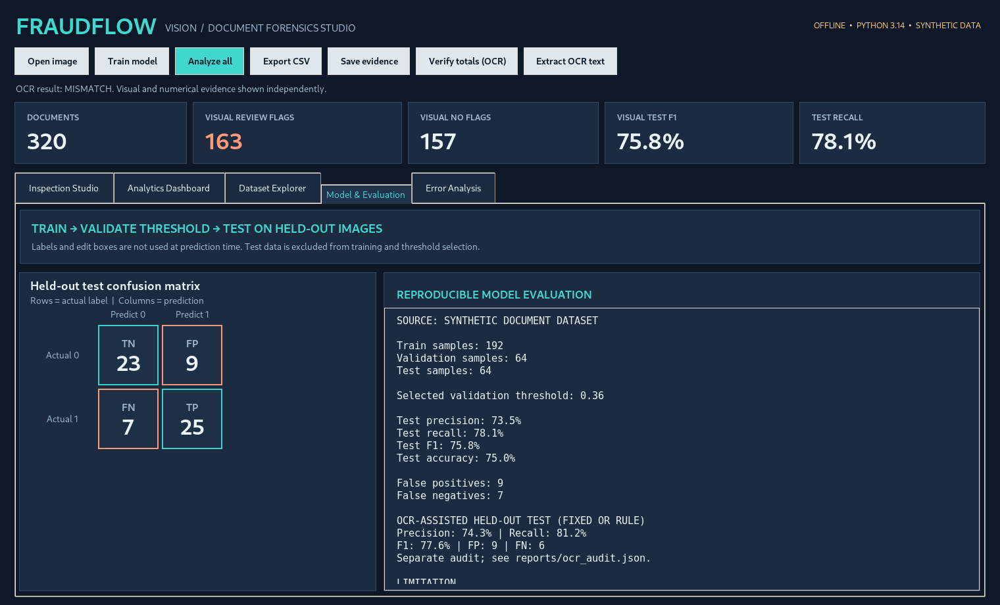
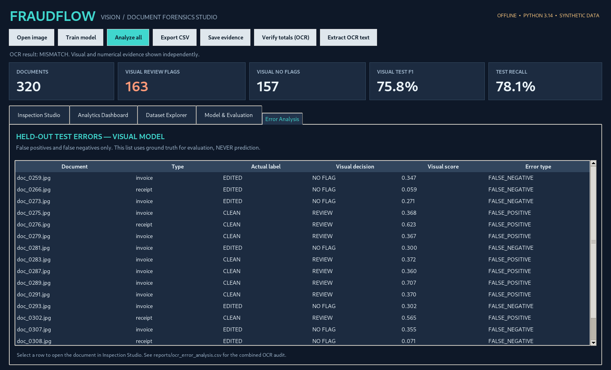
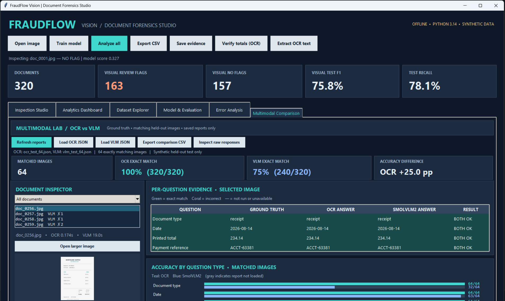

# FraudFlow Vision — Document Forensics & Multimodal VQA

**Windows desktop application | Computer Vision + Tesseract OCR + pretrained SmolVLM2 VQA evaluation**

FraudFlow Vision demonstrates an end-to-end **synthetic document alteration screening** workflow. Browse 320 fictional receipt and invoice images, compare two independent signals (visual patch-artifact screening and OCR subtotal/tax/total consistency), inspect a suggested visual region, and review transparent, held-out evaluation results and error cases.

> **Scope:** Engineering portfolio prototype. The project detects selected artificial alteration patterns; it cannot determine whether a document is genuine or whether fraud occurred. No personal, bank, company or employer document data is included. **NO FLAG does not mean authenticated.**



## Actual desktop screens

| Visual inspection + OCR | Analytics dashboard |
|---|---|
|  |  |

| Dataset Explorer | Held-out Model Evaluation |
|---|---|
|  |  |




## Multimodal research: Tesseract OCR vs SmolVLM2

**Research question:** How does a deterministic Tesseract OCR + field-rule baseline compare with a pretrained vision-language model (VLM) on fixed questions about synthetic receipts and invoices?

The VQA benchmark asks **five questions per image**: document type, date, printed total, payment reference, and subtotal-plus-tax arithmetic consistency. The expected answers are derived from the **synthetic document generator**, never supplied to either inference method. Both methods use the same image files; the VLM receives image-plus-text questions, while the OCR baseline parses recognized text with field rules.

### Measured visual question-answering results — full held-out test

Two independently executed pipelines were evaluated on the **same 64 held-out synthetic receipt/invoice images**, with **five questions per image**. The expected answers come from the document generator and are used for scoring only.

| Method | Documents | Correct / evaluated answers | Micro exact-match accuracy |
|---|---:|---:|---:|
| Tesseract OCR + field rules | 64 | **320/320** | **100%** |
| Pretrained SmolVLM2-500M | 64 | **240/320** | **75%** |

**Observed difference:** OCR achieved **25.0 percentage points** higher exact-match accuracy on this fixed synthetic test set. A prior **10-image pilot** scored OCR 50/50 (100%) and SmolVLM2 40/50 (80%); those pilot results should **not** replace the full-set results above.

These full-set results were displayed by the desktop comparison tool using the locally generated `reports/multimodal/ocr_test_64.json` and `reports/multimodal/vlm_test_64.json` files. **Include the two original report files when publishing reproducible results**; do not substitute invented predictions or treat the screenshot as equivalent to raw evidence. You can validate the reports and their aligned document IDs with `python -m multimodal.compare` (command below).

**Important limitation:** These are highly regular fictional documents and five fixed field-reading questions. The OCR baseline uses dataset-aware extraction rules, so its perfect score does **not** imply perfect OCR on real-world documents. These figures are **not fraud-detection accuracy**. No LoRA/QLoRA fine-tuning was performed.

### Interactive desktop comparison

The **Multimodal Comparison** tab reads saved OCR and VLM result JSON files. It displays:

- The selected source receipt/invoice image.
- Five questions with **ground truth, OCR answer, and SmolVLM2 answer** side by side.
- Green/red correctness indicators, raw predictions, and per-question accuracy summaries.
- A filter for VLM errors, larger image viewing, and CSV export.

The tab evaluates **only shared document IDs**, and the displayed full-set screenshot pairs the **64 OCR and 64 VLM test images**. It does **not** rerun or download the VLM when opened.



*Actual Windows application screenshot provided after the complete 64-image VLM run. The document inspector also shows individual answers, correctness, and a per-question breakdown. Results reflect synthetic test data only.*

Run and reproduce the experiments:

```powershell
# Compare OCR on all 64 held-out synthetic documents
.\.venv\Scripts\python.exe -m multimodal.evaluate --method ocr --split test

# Start with a small VLM trial; downloads model weights on first run
.\.venv\Scripts\python.exe -m multimodal.evaluate --method vlm --split test --limit 2

# Reproduce the measured full VLM benchmark (requires model weights)
.\.venv\Scripts\python.exe -m multimodal.evaluate --method vlm --split test
# Compare saved 64-image reports without re-running inference
.\.venv\Scripts\python.exe -m multimodal.compare --ocr reports/multimodal/ocr_test_64.json --vlm reports/multimodal/vlm_test_64.json
```

The comparison command requires your original VLM JSON file from the completed local run; it validates that both reports cover the same ordered 64 held-out images. It also creates `reports/multimodal/comparison_test.json`.

See [VLM study protocol](docs/VLM_STUDY.md), [comparison GUI guide](docs/VISUAL_COMPARISON.md), and [LoRA proposal — not executed](docs/LORA_PROTOCOL.md). The visual classifier and the optional VLM are **separate systems for separate tasks**: alteration screening vs document question answering.

## Implemented features

- **Real image files:** 320 generated JPG images: 160 invoices + 160 receipts; each type has 80 clean and 80 edited samples. Different document values and paper textures are independently generated.
- **Corrected synthetic generator:** Edited `total` fields remain currency values even when the overlay is marked `seamless_total`. Same for date and reference edits. Original and replacement values are stored separately as ground truth; displayed line items now add to the displayed subtotal.
- **Pixel-based visual model:** Eight handcrafted horizontal/vertical edge and seam features extracted with Pillow; pure-Python logistic regression, standardization learned on training data, threshold chosen from validation F1. No TensorFlow, PyTorch, SciPy or scikit-learn required.
- **On-demand OCR arithmetic:** Optional local Tesseract reads printed **Subtotal**, **Tax**, and **TOTAL** and checks whether subtotal + tax matches the printed total to within $0.01. It reports `CONSISTENT`, `MISMATCH`, `UNREADABLE`, or `OCR_UNAVAILABLE`.
- **Separate evidence and combined review:** Visual screening and OCR checking appear independently. After OCR is run for an image, the predefined combined decision is REVIEW if **either** the visual classifier flags it **or** arithmetic mismatch is detected. Missing OCR never counts as verified.
- **Inspection Studio:** Native Windows-style GUI, image gallery, inferred hot-zone overlay (not copied from generator truth), and evidence export as JSON/annotated PNG.
- **Analytics Dashboard:** Score histogram and counts across bundled samples; visual model scores are **uncalibrated**, not financial fraud probabilities.
- **Dataset Explorer and Error Analysis:** Search/filter records, inspect known synthetic ground truth, and browse false positives/false negatives from the held-out **visual model** test set.
- **Model & Evaluation:** Train/validation/test protocol, confusion matrix, separate visual-only and OCR-assisted evaluations, plus machine-readable reports.
- **Engineering:** Python `unittest`, GitHub Actions CI, model persistence, CSV export, and offline visual-model evaluation. The optional pretrained VLM requires a model download on first use, but the desktop GUI needs no localhost, external server, or OpenAI API.

## Two complementary inspection signals

```text
Receipt / invoice image (JPG, PNG)
  ├── VISUAL PATH: resize and grayscale → 8 seam/edge features
  │       → standardized logistic regression → visual score
  │       → validation-selected threshold → VISUAL REVIEW / NO FLAG
  │       → pixel-derived *suggested* hot-zone
  │
  └── OPTIONAL OCR PATH: local Tesseract → printed subtotal, tax, total
          → Decimal arithmetic verification → CONSISTENT / MISMATCH / UNREADABLE

Combined review rule (only when OCR requested):
  REVIEW if (visual review) OR (OCR arithmetic MISMATCH)
  NO FLAG otherwise — never a guarantee of authenticity.
```

**Limitations:** A visually modified *date* or *payment reference* can have a mathematically consistent total. An original receipt can also contain a legitimate formatting variation. Image artifacts and arithmetic inconsistencies are **risk indicators**, not fraud labels. OCR is not currently used to train the logistic-regression classifier.

## Synthetic dataset and ground truth

| Split | Clean | Edited | Total |
|---|---:|---:|---:|
| Training | 96 | 96 | 192 |
| Validation | 32 | 32 | 64 |
| Test | 32 | 32 | 64 |
| **Total** | **160** | **160** | **320** |

The generator knows which fields it drew and which were replaced; it stores this *ground truth* in `data/manifest.csv` with `file`, `split`, `document_type`, `label`, `edit_type`, `bbox`, `original_value`, and `replacement_value`. **The model does not receive these labels, original values, replacement values, or bounding boxes to make predictions.** They are used for evaluation and transparent inspection only.

New sample variations include *total edits*, *date edits*, *reference edits*, more subtle patch redraws, and benign marks on some clean documents. Both classes occur across receipt/invoice layouts and splits.

## Reproduced results (fixed synthetic dataset, seed 31415)

**VISUAL-ONLY, 64 held-out test images**

| Metric | Result |
|---|---:|
| Precision | 73.53% |
| Recall | 78.12% |
| F1 | **75.76%** |
| Accuracy | 75.00% |
| TP / TN / FP / FN | 25 / 23 / 9 / 7 |

**OCR-ASSISTED COMBINED RULE, same 64 held-out images (local Tesseract)**

| Metric | Result |
|---|---:|
| Precision | 74.29% |
| Recall | 81.25% |
| F1 | **77.61%** |
| Accuracy | 76.56% |
| TP / TN / FP / FN | 26 / 23 / 9 / 6 |

OCR audit coverage on this particular test: 57 arithmetic-consistent, 7 mismatched, 0 unreadable. Both result sets are **synthetic holdout scores only**; they do not measure accuracy on real receipts, invoices, or financial fraud cases.

**Leakage controls:** Images are generated independently for each split. Logistic weights and feature normalization use training data only; the `0.36` visual threshold was chosen on validation data. The combined logic is a predefined OR rule and was not tuned on the held-out test labels. Synthetic truth is used only to calculate metrics and list errors.

Reproducible output files: [`reports/evaluation.json`](reports/evaluation.json), [`reports/test_predictions.csv`](reports/test_predictions.csv), [`reports/error_analysis.csv`](reports/error_analysis.csv), [`reports/ocr_audit.json`](reports/ocr_audit.json), [`reports/ocr_test_predictions.csv`](reports/ocr_test_predictions.csv), and [`reports/ocr_error_analysis.csv`](reports/ocr_error_analysis.csv). A concrete sample appears in [`reports/example_doc_0006_evidence.json`](reports/example_doc_0006_evidence.json) with [`annotated image`](reports/example_doc_0006_annotated.png).

## Run on Windows (Python 3.14)

Clone or open this repository in a folder of your choice. The following commands use `D:\FraudFlow-Vision-Multimodal-Lab` as an example:

```powershell
cd D:\FraudFlow-Vision-Multimodal-Lab
py -3.14 -m venv .venv
.\.venv\Scripts\python.exe -m pip install --upgrade pip
.\.venv\Scripts\python.exe -m pip install -r requirements.txt
.\.venv\Scripts\python.exe -m fraudvision.desktop
```

The **desktop inspection application does not require a browser, localhost, cloud API, GPU, or downloaded VLM weights**. Python's Tkinter usually ships with the python.org Windows installation. Alternatively run `RUN_WINDOWS.bat` if it matches your Python setup.

**Optional OCR:** Install [Tesseract OCR](https://github.com/tesseract-ocr/tesseract), with `tesseract.exe` on your `PATH` or at `C:\Program Files\Tesseract-OCR\tesseract.exe`. The app's OCR and arithmetic verification controls require Tesseract; all other desktop inspection features work without it.

**Optional pretrained VLM (separate dependencies):** The multimodal experiment requires PyTorch, TorchVision, Transformers, `num2words`, and other packages from `requirements-vlm.txt`. This example installs compatible **CPU** builds from the official PyTorch wheel index:

```powershell
.\.venv\Scripts\python.exe -m pip install torch torchvision --index-url https://download.pytorch.org/whl/cpu
.\.venv\Scripts\python.exe -m pip install -r requirements-vlm.txt
.\.venv\Scripts\python.exe -m pip install num2words

# Run VLM on two held-out examples first
.\.venv\Scripts\python.exe -m multimodal.evaluate --method vlm --split test --limit 2
```

The VLM downloads pretrained model weights from [Hugging Face](https://huggingface.co/HuggingFaceTB/SmolVLM2-500M-Video-Instruct) on the first run (about 2 GB in the observed run). CPU inference can be slow. This model download is **not included in the repository**, and the optional VLM experiment is not an offline-first feature until the model is cached locally. For GPU use, choose compatible packages from the [official PyTorch installation guide](https://pytorch.org/get-started/locally/).

### Five-minute desktop tour

1. Open **Inspection Studio**, choose `doc_0006.jpg`, click **Verify totals (OCR)**, and view the arithmetic difference (`271.53 + 19.01 = 290.54` vs printed `$351.54`).
2. Toggle **Show inferred visual hot-zone**; the overlay is a pixel heuristic, **not** the stored ground-truth box.
3. Visit **Analytics Dashboard** for actual model-score distributions and review counts (visual-only unless each record is individually OCR-checked).
4. Explore **Dataset Explorer**, including separate labels and predictions. Look for missed edits or false flags.
5. Visit **Model & Evaluation** and **Error Analysis** to inspect precision, recall, F1, the test confusion matrix, and actual FP/FN samples.
6. Try **Open image**, **Save evidence**, and **Export CSV**. Evidence JSON includes OCR status and the combined decision when OCR has been run.

### Development and reproducibility

```powershell
py -3.14 -m unittest discover -s tests -v
py -3.14 -m fraudvision.cli inspect data/images/doc_0006.jpg
py -3.14 -m fraudvision.cli verify data/images/doc_0006.jpg
py -3.14 -m fraudvision.cli train
py -3.14 -m fraudvision.cli audit-test
```

`audit-test` requires local Tesseract and may take a few minutes to read all 64 held-out images. It reports scores separately without training on test labels. To regenerate the dataset (overwrites JPGs/ground truth; retraining required):

```powershell
py -3.14 -m fraudvision.generator --count 320
py -3.14 -m fraudvision.cli train
py -3.14 -m fraudvision.cli audit-test
```

Retraining should also regenerate `data/demo_predictions.csv` before sharing new cached demo results (the desktop **Train model** button updates this cache automatically).

## Project structure

```text
fraudvision/                  Image generator, handcrafted visual features,
                              logistic classifier, OCR checks, GUI, audit and CLI
multimodal/                   VQA answer key, OCR baseline, pretrained VLM runner,
                              comparison and evaluation scripts
screenshots/                  Captured desktop screens, including comparison tab
data/images/                 320 bundled synthetic JPG documents
data/manifest.csv            Ground-truth labels and bounding boxes (evaluation only)
data/demo_predictions.csv    Cached visual classifier outputs
models/demo_model.json      Bundled trained visual classifier
reports/                     Visual screening, OCR auditing, and VQA evaluations
reports/multimodal/          Saved OCR/VLM reports (64-image VLM JSON produced locally)
docs/                        Dataset, model, benchmark and LoRA documentation
tests/                       unittest suite
.github/workflows/ci.yml    GitHub Actions automated tests
RUN_WINDOWS.bat             Windows desktop launcher
```

## Third-party models and licenses

- **[SmolVLM2-500M-Video-Instruct](https://huggingface.co/HuggingFaceTB/SmolVLM2-500M-Video-Instruct)** — pretrained vision-language model by Hugging Face; distributed under **Apache License 2.0**. The checkpoint is downloaded separately and its weights are not included here. Refer to the model card for its intended use and limitations.
- **[Tesseract OCR](https://github.com/tesseract-ocr/tesseract)** — optional OCR engine, **Apache License 2.0**; installed separately.
- **[Pillow](https://python-pillow.github.io/)** — image handling and rendering; subject to its own license.
- The original project source is distributed under this repository's **[MIT license](LICENSE)**. Third-party licenses continue to apply to their respective components.

## Responsible use / technical boundaries

- Not a forensic authentication system; a review flag does not prove fraud.
- No real-world benchmark, adversarial test, or calibration of model scores.
- The OCR check only tests one arithmetic relation and cannot verify dates, references, identities, business provenance, or source-of-truth transactions.
- OCR errors can produce an unreadable result or a false mismatch; a human should inspect the actual source image.
- The images, company names and invoices are fictional; no third-party personal documents are included.
- Tesseract, Pillow, PyTorch, and the pretrained VLM are third-party components with their own licenses; see attribution above.

See [`docs/DATA_CARD.md`](docs/DATA_CARD.md), [`docs/MODEL_CARD.md`](docs/MODEL_CARD.md) and [`docs/RECRUITER_WALKTHROUGH.md`](docs/RECRUITER_WALKTHROUGH.md) for details.

**Portfolio:** [dharati-cv-ml](https://github.com/dharati-cv-ml)
